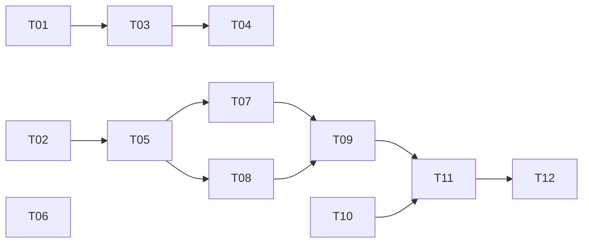

# Schedule, Dependencies and Budget - CampusHelp

Calendar: Day 1 = Tue 17 Nov 2026 ... Day 10 = Mon 30 Nov 2026 (weekends excluded).

| Day | 1 | 2 | 3 | 4 | 5 | 6 | 7 | 8 | 9 | 10 |
|---|---|---|---|---|---|---|---|---|---|---|
| Date | 17 Nov | 18 Nov | 19 Nov | 20 Nov | 23 Nov | 24 Nov | 25 Nov | 26 Nov | 27 Nov | 30 Nov |
| Milestone | | M1 | | M2 | | | M3 | | | M4 |

## 1. Task schedule

| ID | Task | Owner (role) | Hours | Start | Due | Milestone | Priority |
|---|---|---|---|---|---|---|---|
| T01 | Develop project charter | A | 4 | 17 Nov | 18 Nov | M1 | High |
| T02 | Gather stakeholder requirements | B | 4 | 17 Nov | 18 Nov | M1 | High |
| T03 | Prepare scope and WBS | C | 4 | 18 Nov | 18 Nov | M1 | Medium |
| T04 | Schedule, dependencies and budget | A | 4 | 19 Nov | 20 Nov | M2 | High |
| T05 | Design initial wireframes | B | 4 | 19 Nov | 20 Nov | M2 | Medium |
| T06 | Risk register and quality plan | C | 4 | 19 Nov | 20 Nov | M2 | Medium |
| T07 | Student request interface prototype | B | 4 | 23 Nov | 24 Nov | M3 | High |
| T08 | Administrator dashboard prototype | A | 4 | 23 Nov | 24 Nov | M3 | High |
| T09 | Prepare and execute test cases | C | 4 | 24 Nov | 25 Nov | M3 | High |
| T10 | Evaluate and document change request | A | 3 | 24 Nov | 26 Nov | M4 | Medium |
| T11 | Final verification and issue review | C | 3 | 26 Nov | 27 Nov | M4 | High |
| T12 | Final report and closure | B | 3 | 27 Nov | 30 Nov | M4 | Medium |

## 2. Dependencies

| Task | Predecessor | Type |
|---|---|---|
| T02 Requirements | None | - |
| T03 WBS | T01 | Finish-to-Start |
| T04 Schedule | T03 | Finish-to-Start |
| T05 Wireframes | T02 | Finish-to-Start |
| T07 Student interface | T05 | Finish-to-Start |
| T08 Admin interface | T05 | Finish-to-Start |
| T09 Testing | T07 and T08 | Finish-to-Start |
| T11 Final verification | T09 and T10 | Finish-to-Start |
| T12 Final report | T11 | Finish-to-Start |

### Dependency diagram

Longest (critical) path: **T02 -> T05 -> T07/T08 -> T09 -> T11 -> T12** = 4 + 4 + 4 + 4 + 3 + 3 = 22 working hours. The path T01 -> T03 -> T04 is 12 h and has float.

## 3. Tasks that could delay the whole project

| Task | Why it can delay the project |
|---|---|
| **T05 Wireframes** | Both prototypes (T07, T08) cannot start until it is finished; any delay moves two tasks at once, and then T09, T11, T12. |
| **T09 Testing** | Needs both prototypes; it joins two parallel branches, so the later one decides the start. Defects found here create rework before closure. |
| **T11 Final verification** | Needs T09 and T10 (change request); a late change-request decision or failed tests directly delays the final report T12 and milestone M4. |

(T07/T08 are also near-critical because the same person builds both.)

## 4. Budget

Rate: **50,000 UZS per person-hour** (academic assumption).

| Phase | Tasks | Hours | Cost (UZS) |
|---|---|---|---|
| Initiation (M1) | T01-T03 | 12 | 600,000 |
| Planning (M2) | T04-T06 | 12 | 600,000 |
| Execution (M3) | T07-T09 | 12 | 600,000 |
| Monitoring & Closure (M4) | T10-T12 | 9 | 450,000 |
| **Total baseline** | | **45** | **2,250,000** |

Per task: 4 h = 200,000 UZS; 3 h = 150,000 UZS. No other costs (no licences, hosting or external services).

Contingency: none reserved in the baseline. Success criterion SC5 allows up to +10 % (4.5 h = 225,000 UZS) of variance.

> If the Day 6 change request is approved, the baseline would grow by 3 h / 150,000 UZS to 48 h / 2,400,000 UZS - see `change-request.md`.
