# Scope and Work Breakdown Structure (WBS) - CampusHelp

## Scope statement

**In scope:** request submission, categories/priorities, tracking by ID, administrator assignment, status updates, dashboard - delivered as requirements, wireframes, a clickable prototype and project-management documents.
**Out of scope:** real authentication, production server, database, live SMS/e-mail services.

## WBS hierarchy

```mermaid
graph TD
    P[CampusHelp Project]
    P --> A[1 Initiation]
    P --> B[2 Planning]
    P --> C[3 Execution]
    P --> D[4 Monitoring & Control]
    P --> E[5 Closure]
    A --> A1[1.1 Project charter - T01]
    A --> A2[1.2 Stakeholder requirements - T02]
    A --> A3[1.3 Scope and WBS - T03]
    B --> B1[2.1 Schedule, dependencies, budget - T04]
    B --> B2[2.2 Initial wireframes - T05]
    B --> B3[2.3 Risk register and quality plan - T06]
    C --> C1[3.1 Student request prototype - T07]
    C --> C2[3.2 Admin dashboard prototype - T08]
    C --> C3[3.3 Test cases and execution - T09]
    D --> D1[4.1 Progress checkpoints - Day 2, 5, 8]
    D --> D2[4.2 Change request - T10]
    E --> E1[5.1 Final verification and issue review - T11]
    E --> E2[5.2 Final report and closure - T12]
```

## Work package table

| WBS | Work package | Deliverable | Issue | Hours | Milestone |
|---|---|---|---|---|---|
| 1.1 | Project charter | `docs/project-charter.md` | T01 | 4 | M1 |
| 1.2 | Stakeholder requirements | `docs/requirements.md` | T02 | 4 | M1 |
| 1.3 | Scope and WBS | `docs/wbs.md` | T03 | 4 | M1 |
| 2.1 | Schedule, dependencies, budget | `docs/schedule-and-budget.md` | T04 | 4 | M2 |
| 2.2 | Initial wireframes | `docs/wireframes.md` | T05 | 4 | M2 |
| 2.3 | Risk register and quality plan | `docs/risk-register.md`, `docs/quality-plan.md` | T06 | 4 | M2 |
| 3.1 | Student request interface prototype | `prototype/student.html` | T07 | 4 | M3 |
| 3.2 | Administrator dashboard prototype | `prototype/admin.html` | T08 | 4 | M3 |
| 3.3 | Test cases and execution | `docs/test-cases.md` | T09 | 4 | M3 |
| 4.1 | Progress monitoring (continuous) | `docs/progress-checkpoints.md` | - (PM overhead inside T01-T12) | - | M1-M4 |
| 4.2 | Change request | `docs/change-request.md` | T10 | 3 | M4 |
| 5.1 | Final verification and issue review | `docs/verification-report.md` | T11 | 3 | M4 |
| 5.2 | Final report and closure | `docs/closure-report.md`, final PDF | T12 | 3 | M4 |
| | **Total** | | **12 issues** | **45** | |
